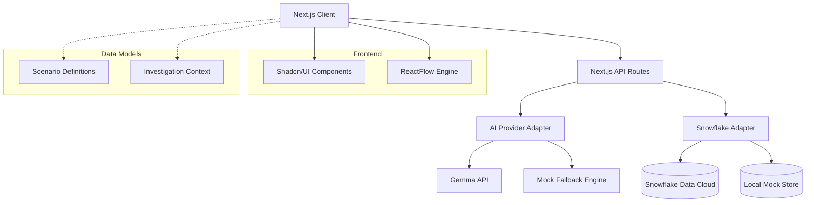

# ShellSentry Architecture

## System Diagram

## AI/Gemma Usage
The AI Copilot utilizes the Gemma model via an abstraction layer (`ai-provider.ts`). It handles:
1. Translating complex Base64 encoded PowerShell into human-readable explanations.
2. Validating the user's current investigation graph against the ground-truth scenario definition.
3. Scoring the final incident report.

## Snowflake Usage
The `snowflake-adapter.ts` logs granular interaction events (e.g., `EVIDENCE_ADDED`, `AI_COPILOT_QUERY`) to build an analytics dashboard of how users learn, highlighting the most commonly missed MITRE ATT&CK techniques.
